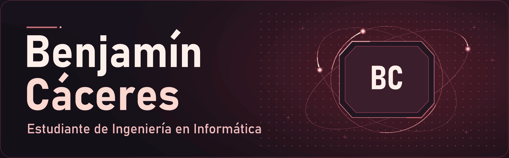
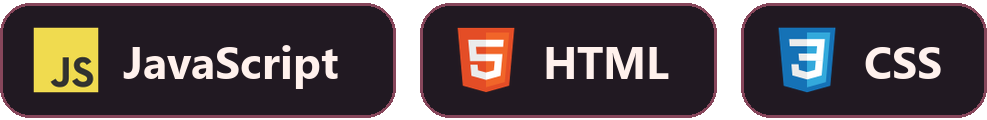

<picture>
  <source media="(prefers-reduced-motion: reduce)" srcset="./perfil-estatico.png">
  
</picture>

Me interesan el **desarrollo web**, la **automatización** y la **ciberseguridad defensiva (Blue Team)**.

[**Proyecto principal**](#necro-intranet) · [**Credenciales**](#certificados-y-credenciales) · [YouTube](https://www.youtube.com/@TheTinky) · [Correo](mailto:benjitatareas17@gmail.com)

## Necro Intranet

**Mi proyecto principal** es una intranet estudiantil personal. Trabajo en la interfaz web y en la API REST con autenticación de usuarios.

**Frontend** · `React` `Vite`  
**Backend** · `Django REST Framework` `JWT`

## Otros proyectos

### [Feria Libre Digital ↗](https://github.com/Benjamin16caceres/proyecto-yaleni)

Proyecto colaborativo para ferias libres, con catálogo y carrito para vecinos y un panel de precios y stock para emprendedores.

`React` `Vite` `Node.js` `Express` `Docker Compose`

## Certificados y credenciales

Cursos ofrecidos por **INACAP, sede Puente Alto**, a través de **Cisco Networking Academy**.

- [**Introducción a la IA moderna**](https://www.credly.com/badges/17e753fc-216f-4162-bf4c-1cf93e17830f/public_url) · 15 de septiembre de 2026
- [**Conciencia sobre seguridad y protección digital**](https://www.credly.com/badges/4b1315b2-bc69-4565-af46-c4c32ab7d05c/public_url) · 20 de octubre de 2026

**Amazon Web Services Training and Certification**

- [**AWS Academy Graduate · Cloud Security Foundations**](https://www.credly.com/go/a74kS9LX) · Insignia de formación de 20 horas · 13 de noviembre de 2026
