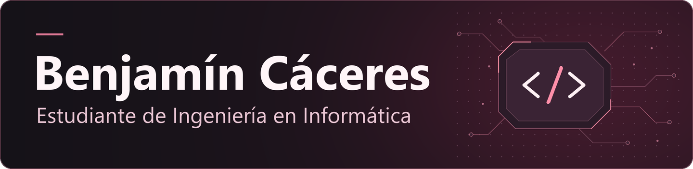

Me interesan el **desarrollo web**, la **automatización** y la **ciberseguridad defensiva (Blue Team)**.

[Correo](mailto:benjitatareas17@gmail.com) · [YouTube](https://www.youtube.com/@TheTinky)

## Proyecto destacado

### [Feria Libre Digital](https://github.com/Benjamin16caceres/proyecto-yaleni)

Proyecto colaborativo para ferias libres. Los vecinos pueden buscar productos y armar su carrito. Los emprendedores cuentan con un panel para gestionar su catálogo, precios y stock.

- **Frontend** · `React` `Vite` `JavaScript` `HTML` `CSS`
- **Backend** · `Node.js` `Express` `JSON`
- **Herramientas de desarrollo** · `Git` `GitHub` `Docker Compose`

## Certificados y credenciales

Cursos ofrecidos por **INACAP, sede Puente Alto**, a través de **Cisco Networking Academy**.

- **Conciencia sobre seguridad y protección digital** · 20 de octubre de 2026
- **Introducción a la IA moderna** · 15 de septiembre de 2026

**Amazon Web Services Training and Certification**

- [**AWS Academy Graduate · Cloud Security Foundations**](https://www.credly.com/go/a74kS9LX) · Insignia de formación de 20 horas · 13 de noviembre de 2026
